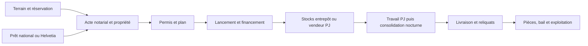

# Audit de la chaîne immobilière — Human Gambit

Diagnostic du **20 octobre 2026**, code de référence `baa9cb7e2b7f89db66cf268d21382deb0be2a3a2`. Branche de diagnostic : `codex/audit-chaine-immobiliere-20261020`.

## Verdict et portée des preuves

**La chaîne complète ne peut pas être qualifiée de fiable ou de validée en production.** Des ruptures d'autorité, de paiement, de crédit bancaire et de progression sont reproductibles dans le code conservé. Le présent chantier ne corrige pas le gameplay : il livre la cartographie, les preuves et l'ordre de stabilisation.

Les nouveaux scénarios produisent **33 constats locaux : 29 reproductions d'anomalies et 4 garanties observées**. Plusieurs reproductions concernent une même cause ; ce ne sont ni 29 incidents constatés en production, ni 29 failles indépendantes. Les garanties locales ne valident pas le jeu réel.

Le baseline porte un relevé du **13 octobre 2026**, antérieur à plusieurs changements du client. Les fonctions SQL citées sont celles de cette photographie. Aucun connecteur Supabase n'est exposé dans cette session ; les accès HTTPS au projet Supabase et au site Vercel sont refusés au tunnel réseau (`CONNECT 403`). Il est donc impossible de certifier leurs définitions, droits, déclencheurs et données **actuellement** déployés. Aucun test authentifié, achat, emprunt, travail ou transfert réel n'a été exécuté, sur Angie, Arnie ou un autre bêta-testeur.

Les sources applicatives, migrations de gameplay et fichiers générés sont inchangés. Les seuls ajouts sont des outils d'audit, un prévol en lecture seule, les résultats et ce rapport.

### Lecture des états

- **Codé** : mécanisme trouvé dans le dépôt, avec sa porte et ses limites identifiées.
- **Déployé** : état présent confirmé sur le service réel. **Non certifié ici** pour les étapes ci-dessous ; un commentaire « migration installée » ou une ancienne photographie ne suffit pas.
- **Validé** : succès authentifié dans le jeu réel, avec ses contreparties. **Aucune étape n'obtient ce statut dans cet audit.**



## 1. Choisir et acquérir un terrain

### Ce que le joueur rencontre

`WORLD` et `BUILDINGS` dans `data.js` déclarent **36 terrains dans les douze villes ordinaires** :

| Pays | Capitale | Ville A | Ville B |
| --- | --- | --- | --- |
| Républia | Luthécia : lots 1–5 | Port-Sainte-Marie : lots 8–11 | Montrouge : lot 6 et lots `montrouge-3/7/8/9/12` |
| El Estado | Ciudad Roja : 1/4/5/6/7 | Puerto Negro : 3 | Villa Sangre : 2 |
| République soviétique | Novomirsk : 1/4/5/6/7 | Starovka : 3 | Krasnov : 2 |
| Khalija | Al Madina : 1/4/5/6/7 | Oasis City : 3 | Al-Petrol : 2 |

Le nombre de terrains **encore disponibles** n'est pas connu sans lecture des états vivants. La carte exhaustive des identifiants déclarés est dans le JSON de résultats. Républia dispose d'accès par rues/scènes et sous-plans ; les quatre vues contextuelles du carrefour de Port-Sainte-Marie n'ont pas été modifiées ni considérées comme anormales.

Deux parcours existent : achat direct avec dépôt et rendez-vous, ou compromis avec clauses de prêt/permis ; le rachat d'un bien saisi par Helvetia a des RPC spécifiques. Dans le chemin direct, `doAcheterTerrain` demande 2 PA et 1 000 FR, calcule une surface à 12 FR/m², fixe un rendez-vous après 2 à 7 jours et une tolérance de 24 heures. Le compromis ordinaire porte un acompte de 1 000 FR. La signature demande 1 PA et le solde ; le conjoint peut recevoir une copropriété dans le patch de mutation.

### Raccordements et persistance

- `plateau-pnj.js:4341` : surfaces, prix au m² et dépôt ; `doAcheterTerrain`, `doConfirmerCompromis`, `finaliserAchatTerrain`.
- `plateau-justice-economie.js:5304` : `doActeVenteTerrain` et `traiterActeVente` ; `getTousLesTerrainsPays`, `getVilleTerrain`.
- `supabase.js` : `sbGetTerrainState` ; `plateau-justice-economie.js:5082` : cache, chargement et remplacement de l'état serveur.
- SQL : `terrain_compromis_acte`, `terrain_proprietaire_muter`, helpers de fusion/verrouillage, dans `baseline/domaines/immobilier-et-territoire/20_fonctions.sql`.
- État persistant : `terrains_etat.data` est du **texte JSON** ; propriétaire aussi en colonne ; compromis/rendez-vous/prêt/permis/chantier dans ce blob. Historique dans `terrains_historique_ventes`. La mutation et la consommation de la réservation sont dans un même patch ; **le paiement reste une opération séparée**.

Les écritures REST directes sur `terrains_etat` sont fermées au client dans le baseline. Les RPC publiques emploient des fonctions `SECURITY DEFINER`, un acteur authentifié et, pour certaines transitions, un verrou et un contrôle de titre. Cela ne garantit pas que tout le cycle soit autorisé : les preuves suivantes passent par les RPC, pas par un UPDATE REST interdit.

### Défauts démontrés

- **I01/I02** : un compromis peut être posé sur le bien d'un tiers ; le titre ainsi acquis permet une mutation sans paiement. `terrain_proprietaire_muter` fusionne un patch non limité aux champs justifiés et accepte notamment une autorisation de construction transmise.
- **I03** : le titre `serveur` ne vérifie pas un rôle de service ; il vérifie seulement que `mon_personnage()` est nul. Le rôle `authenticated`, auquel la fonction est accordée, peut donc l'utiliser sans personnage dans la fixture.
- **I14** : sur une première ligne inexistante, deux revendications concurrentes répondent toutes deux `ok`, alors qu'un seul compromis est stocké. Le helper fait `INSERT ... ON CONFLICT DO NOTHING` puis renvoie le patch du perdant comme s'il avait été enregistré. À distinguer de la garantie positive sur le lancement d'un chantier déjà persisté.
- **J07** : lorsque le paiement aboutit (simulé dans ce scénario), le dépôt est prélevé avant l'appel de réservation ; un refus ou une réponse perdue ensuite n'est pas réconcilié atomiquement.
- **I15/J09** : avec le miroir produit par le générateur canonique, `payer_ordre` refuse `acheter_terrain`, 2 PA, 1 000 FR : ce triplet n'est pas déclaré. Les montants déclarés commencent à 3 500 FR. La reproduction emploie le vrai SQL de paiement.
- **I16/J10** : le solde notarial variable est envoyé à `payer_ordre`, mais `officialiser_transaction` n'admet que 1 PA/0 FR dans ce miroir. Le solde témoin de 23 000 FR est refusé. Le miroir vivant doit être vérifié ; ajouter arbitrairement des prix à sa déclaration ne serait pas une correction.
- **I10/J13** : plusieurs portes recherchent un `building_id` sans pays. Le classement client `getVilleTerrain` réutilise les seules listes de Républia : neuf terrains des autres empires sont rattachés à une mauvaise ville. L'identifiant homonyme permet également une modification inter-pays dans le banc SQL.
- **J08** : les quatre terrains de Port-Sainte-Marie sont décrits à 1 500 m², mais absents de `SURFACE_TERRAINS` : l'achat direct retient 2 000 m² et 24 000 FR. Le lot historique 6, dont la surface est explicitement indéterminée, est aussi exposé au repli à 2 000 m².

**Revente/transfert :** transfert de compromis, copropriété, successions, préemption et ventes de biens saisis existent. Le code précise que la revente générale entre joueurs n'est pas encore ouverte ; ne pas la déduire de la seule existence d'une RPC de mutation. Déconnexion/rechargement relisent le serveur ; une réservation rejetée ou un paiement isolé n'est pas réparé par ce rechargement.

**État :** codé, mais acquisition ordinaire bloquée ou insuffisamment sûre dans la photographie auditée ; déploiement actuel non certifié ; non validé en jeu.

## 2. Financer le terrain ou les travaux

### Les trois circuits, à ne pas confondre

| Circuit | Conditions et règles codées | Porte et persistance |
| --- | --- | --- |
| Prêt de compromis immobilier | Demande client entre 1 000 et 150 000 FR ; taux national `5 + IE/10`, total arrondi au franc, échéance arrondie au supérieur. À résolution, acceptation si `arg` couvre 10 % du montant, sinon chance de 50 %. | `doConfirmerCompromis` → `pretDemande` dans le terrain → `compromis_expire_resoudre` appelé par le cron → table `prets`. |
| Prêt national travaux/consommation | Travaux sans plafond client explicite ; consommation ≤10 000 FR, ≤30 jours, taux fixe 12 %. Un actif par type vérifié dans l'interface. | `confirmerPretBancaire` appelle **`pret_national_contracter`** ; sa définition SQL est absente des fichiers conservés examinés. Le contrat serveur et ses plafonds ne peuvent être certifiés. |
| Prêt Helvetia | Compte Helvetia exigé ; 1 000–150 000 FR, 5–30 jours, un prêt actif/contentieux, intérêt total 12 %. | `creer_pret_helvetia` : prêt, caisse, compte Helvetia et `arg` modifiés dans une transaction SQL. Liquidité/refinancement et contentieux via moteurs spécifiques. Vérification ici par lecture seulement. |

`plateau-core.js:1881` hydrate les comptes comme **map par nom de banque**, pas comme tableau. Les fonds ordinaires sont le liquide et le compte national ; le helper SQL `helvetia_debiter_fonds_ordinaires` lit/verrouille ces poches et les débite, avec compatibilité `arg`. Comptes, placements et liquide ne doivent pas être confondus.

### Régression prioritaire des 100 000 FR

**I08 reproduit exactement un contrat immobilier de 100 000 FR enregistré sans versement au compte :** `compromis_expire_resoudre` écrit le prêt et augmente uniquement `personnages.arg`. Le liquide et le compte national restent inchangés. La création de dette est dans la même transaction que l'écriture `arg`, mais cela ne constitue pas un crédit des fonds réellement utilisables. Le déclencheur archivé de la vue réécrit `banque` depuis `NEW` ; aucune alimentation de `comptes_bancaires` n'est trouvée dans ce circuit.

Le banc utilise une projection de fixture pour la vue `personnages`, pas son déclencheur complet : la limite est déclarée, et la conclusion sur l'absence de versement bancaire est également vérifiée dans les sources du déclencheur. L'état présent de ces fonctions doit être lu avant toute conclusion concernant l'incident réel antérieur.

**Le correctif national ne peut pas être déclaré installé.** Son appel est codé, mais ni sa définition ni son enregistrement vivant ne sont disponibles ici. Surtout, le compromis immobilier passe par une **autre porte** : même un `pret_national_contracter` installé et correct ne prouverait pas que le prêt immobilier est protégé.

**J11 :** après un succès serveur simulé du prêt travaux, le vrai handler appelle `.find` sur `state.comptesBancaires`, qui est une map. L'exception survient avant la mise à jour du compte et l'annonce finale. Ce défaut d'affichage/traitement est distinct de l'absence de versement SQL et ne doit pas la masquer.

### Remboursements et défauts

Le cron `preleverPretsBancairesServeur` exclut Helvetia, gèle les prêts antérieurs au 14 septembre et revendique chaque journée par compare-and-swap. Cette protection contre une seconde revendication existe et ses bancs passent. Ensuite, débit du personnage et baisse de dette sont deux requêtes distinctes.

- **J05/J06** : panne du débit ou de l'écriture de dette après revendication → soldes et dette divergent, avec compteur de succès incrémenté ; la journée est déjà consommée. La garde quotidienne n'est pas l'atomicité du remboursement.
- **I12** : les policies et droits archivés de `prets` autorisent un joueur identifié à modifier la dette d'un autre. La contre-épreuve applique les vrais textes de policy/grant, sous rôle `authenticated`.
- **I09** : si le statut du compromis revient en attente, l'octroi peut recréditer `arg` alors que l'INSERT de dette est ignoré par `ON CONFLICT`. Condition explicitement nécessaire : le rejeu normal du compromis accordé est, lui, bloqué (**G02**).
- Défaut national : avertissement, pénalité de 10 % au deuxième impayé, ultimatum au troisième, saisie à partir du quatrième. L'ancien chemin privé a ses frais/malus ; Helvetia dispose d'un contentieux distinct. Ces règles ne sont pas harmonisées par cet audit.

**État :** circuits codés, protection nationale exacte inconnue, défaut immobilier reproduit sur baseline, remboursements non atomiques dans le cron ; déployé/validé actuellement non établis.

## 3. Permis, choix du bâtiment et ouverture du chantier

### Règles trouvées

| Palier | Durée théorique | Coût total | Apport minimum |
| --- | ---: | ---: | ---: |
| Hangar | 6 jours effectifs | 30 000 FR | 10 500 FR |
| Commerce standard | 12 | 60 000 FR | 21 000 FR |
| Commerce premium | 18 | 90 000 FR | 31 500 FR |
| Building | 24 | 120 000 FR | 42 000 FR |

Les coûts découlent de 5 000 FR/jour. Financement cumulé : 35 % pour progresser dans le premier tiers, 70 % pour le suivant, 100 % pour le dernier. Le plan se verrouille aux deux tiers. Le coût se répartit en 30 % matériaux et 70 % travail. Aucun revenu forfaitaire automatique n'est dû après construction : le code rappelle sa suppression ; les revenus supposent une exploitation ou des loyers réels.

Le dépôt de permis porte un palier et éventuellement un plan. Instruction : 2/4/6/10 jours selon le palier. L'adjoint municipal décide dans sa juridiction ; absence de décision vaut accord à l'issue de l'instruction quotidienne. Le zonage client limite notamment Luthécia et Port-Sainte-Marie au premium, Montrouge au building. Il n'est pas réinventé dans ce rapport.

**Sources :** `plateau-chantiers.js`, `plateau-immobilier.js` (surfaces, plans, instruction), `plateau-justice-economie.js:7648` et `:8740` (construction/permis), `traiterInstructionsPermis` dans le cron ; `chantiers_paliers`, `chantiers_besoins_jour`, `terrain_permis_acte`, `chantier_lancer`, `chantier_verser`.

### Ce que le serveur protège et ce qui manque

`chantier_lancer` authentifie l'acteur, verrouille le terrain, exige propriétaire, permis et palier compatible, refuse gel successoral et chantier déjà présent, borne l'apport au gabarit, débite et crée le chantier dans une transaction. **G01** vérifie deux lancements concurrents : un seul chantier et un seul apport. **G03** vérifie le refus sans création si les fonds manquent.

- **I04** : l'absence d'un chantier actif suffit ; un bâtiment déjà construit peut recevoir un deuxième chantier initial. Le contrôle `niveau_construction` de la modale n'est pas répété dans la RPC.
- **I05** : deux répétitions identiques d'un versement sont deux débits tant qu'il reste à financer. Pas de clé de requête/reçu pour reconnaître une réponse perdue. Les deux handlers financiers n'ont pas de verrou de commande commun garantissant cette reprise.
- **I06** : un propriétaire peut envoyer un plan neuf par `terrain_permis_acte` après les deux tiers, avec des surfaces hors limites. Les règles de surface/verrou restent essentiellement dans le client.
- **I07** : `terrain_reamenagement_poser` accepte un objet chantier fourni, déjà marqué achevé et non financé. Le contrôle du propriétaire ne remplace pas le calcul autoritaire du chantier et de ses contreparties.
- Les gardes client de cadavres/squatteurs, les bornes de zonage et plusieurs champs imbriqués ne sont pas tous recalculés par ces portes. Contrôler ces règles ne doit pas consister à dupliquer aveuglément leurs chiffres : réutiliser les référentiels et fonctions pures existants.

Le chantier est un objet dans `terrains_etat.data`, pas une entité indépendante avec clé de génération/requête. Le pays et le bâtiment composent plusieurs identifiants ; d'autres portes les recherchent de façon ambiguë. Un mouvement de propriété peut conserver le chantier. La règle patrimoniale en cas de vente/saisie doit être explicite, pas remplacée par une suppression de données.

**État :** ouverture transactionnelle partiellement protégée ; plans, générations et reprises insuffisamment sécurisés ; aucune validation en jeu réel.

## 4. Acheter, livrer et consommer les matériaux

Trois matériaux de chantier existent : bois, minerai et métal. Références : 5/10/15 FR. Une journée entière de construction utilise 100 bois, 50 minerai, et une séquence métal 33/33/34. Le réaménagement utilise son budget/surface propre. Les gabarits sont dans les seeds générés ; aucun chiffre n'a été modifié.

### Les stocks et chemins réels

1. **Entrepôt local → chantier, à l'ouverture :** `chantier_approvisionner` lit le stock et la trésorerie du chantier sous verrou, vérifie le propriétaire, appelle `approvisionner_chantier` et enregistre les deux contreparties dans la même transaction. L'interne n'est pas directement accordé au joueur. La réserve militaire est soustraite du disponible. Le besoin et l'entrepôt restent partiellement transmis : vérifier leur rattachement autoritaire dans le catalogue vivant.
2. **Entrepôt local → chantier, la nuit :** le cron recalcule lui-même un plan, écrit le stock d'entrepôt, appelle la caisse, paie éventuellement des PNJ, puis remplace le terrain. Ce chemin n'utilise pas la même transaction globale.
3. **Inventaire d'un PJ → chantier :** `vendre_materiaux_chantier` relit inventaire, présence et trésorerie, borne la quantité, retire les objets, ajoute le stock et paie dans une transaction. Prix entier libre, sans plafond : c'est explicitement codé. Le client et le SQL créditent ici surtout `arg`, pas un versement bancaire/liq complet ; reprise financière à inclure dans la stabilisation.

Le stock du chantier peut dépasser le besoin du jour. Le plafond d'entrepôt existe (`capacite_entrepot`), mais l'approvisionnement ne constitue pas une nouvelle entrée d'entrepôt. Ces chemins d'approvisionnement local sont immédiats : aucun ordre de fret, délai ou frais de transport n'est appelé ici. Ce constat n'autorise pas à en inventer.

### Ruptures démontrées

- **J01** : si la sauvegarde du terrain échoue, le stock de l'entrepôt et sa caisse ont déjà bougé, pas le stock du chantier ; le rejeu reproduit l'achat. Un lot n'est donc pas conservé correctement de bout en bout.
- **J02** : le cron ignore la réserve militaire, contrairement au plan client et à l'approvisionnement SQL. Les matières réservées sont achetées par ce chemin.
- **J03** : le remplacement complet du JSON à partir d'une ancienne lecture écrase un apport concurrent, malgré la sûreté de la RPC de versement prise isolément.
- `approvisionner_chantier` conserve dans le baseline une écriture de caisse dans le blob d'entrepôt, alors que le cron utilise `entrepot_caisse_mouvement`. Cette divergence est à confronter au vrai catalogue avant de choisir un correctif : ne pas recréer une seconde caisse.
- La consommation nocturne utilise un arrondi inférieur pour chaque fraction avancée. L'égalité cumulée « matériaux consommés = progression totale » sur des journées très fractionnées reste à éprouver ; elle n'est pas déclarée acquise dans cet audit.
- La vente de matériaux écrit directement l'inventaire par l'ancienne vue. Sa compatibilité avec les RPC de réception/révision récemment installées ne peut pas être certifiée sans les triggers vivants. Un remboursement ou une livraison sur `objets_recus` n'est pas une réception en inventaire ; conserver les deux états distincts.

**État :** transactions manuelles partielles codées, progression nocturne non atomique et divergente ; disponibilité réelle et réception finale non validées.

## 5. Faire travailler les acteurs

Les rôles trouvés sont le propriétaire/maître d'ouvrage, l'adjoint pour l'urbanisme, le notaire, la banque, les ouvriers PJ, les ouvriers PNJ et le fournisseur. **Aucune entreprise BTP distincte n'est nécessaire au moteur trouvé.** L'offre BNE est dérivée des heures utiles/payables. Ne pas présenter une profession ou une obligation administrative supplémentaire comme déjà requise.

`chantier_travailler` prélève les PA, crédite salaire et compteur d'heures, et retire la trésorerie dans une transaction. Travail : **1 PA/heure, 70 FR/heure**, borné par heures utiles, matières, PA et trésorerie. **I13** reproduit cependant un travail rémunéré depuis un autre bâtiment : la RPC ne vérifie pas la présence physique.

Le cron complète les heures utiles par des PNJ selon les stocks/trésorerie et crédite la caisse du ministère des Finances. Ce paiement et la persistance du chantier sont séparés : même famille de risque que J01/J03.

Des formules de sécurité/vol existent : premier vigile −20 au score, suivants −10 ; **le recrutement des vigiles est explicitement absent** dans ce module. Le vol et l'accélération ont des ordres clients, puis `terrain_chantier_acte` ; cette porte borne le stock réel ou recalcule l'avance, mais ne constitue pas à elle seule une transaction complète de PA, coût, aléa, butin et position. Ces contreparties ne doivent pas être considérées sécurisées parce que le stock ne devient pas négatif.

**État :** travail PJ et compléments PNJ codés ; présence, traitements nocturnes et ordres spéciaux à consolider ; recrutement sécurité non implémenté, pas une nouvelle fonctionnalité demandée ici.

## 6. Recevoir le bâtiment et le rendre exploitable

`chantierTermineServeur` exige une durée positive et une progression atteignant cette durée. `livrerChantierServeur` pose le niveau construit, transforme le plan en lots, déplace le chantier dans `chantierAcheve`, vide les stocks/trésorerie actifs et inscrit les reliquats. **G04** confirme cette transformation pure. Le réaménagement partage le moteur et conserve les archives ; une restitution précédente en attente empêche certaines substitutions d'archives.

Les reliquats sont repris par `restituer_reliquats_chantier`, avec verrou et marqueur de restitution. La trésorerie est créditée dans `arg`, les matériaux passent par `objets_recus`, avec identifiants déterministes. La cohérence avec les poches financières et le contrat de réception vivant doit être vérifiée. Le bénéficiaire est notamment contrôlé contre le propriétaire courant, ce qui mérite une règle explicite si le titre a changé depuis la livraison.

- **J04** : la notification « remise des clés » et le compteur de livraison sont produits avant la sauvegarde du terrain. Si cette sauvegarde rend `null`, le code continue ; après relecture, le bâtiment n'est pas livré.
- Les pièces sont hydratées par `plateau-immobilier.js:75` et `:116`, avec restauration différée au chargement. Les lots reçoivent un identifiant et une pièce, mais leur simple création ne signifie pas qu'ils disposent d'un commerce exploitable.
- **I11** : `local_vocation_commerciale` ne reconnaît que les centres commercial/artisanal/d'affaires, pas les parcelles construites. La création d'un fonds dans un lot construit est refusée ; son apport a déjà été écrit par `mouvement_titulaire` avant le `RETURN ok:false`. La contre-épreuve emploie les vraies fonctions, y compris ce mouvement.
- **J12** : la saisie nationale laisse un chantier actif avec propriétaire JSON nul et ancienne colonne `proprietaire` conservée. Cela peut encore progresser la nuit ; aucune doctrine de transfert/règlement du chantier n'est appliquée dans ce chemin.

La parcelle reste localisée par son identifiant existant ; l'image change selon le niveau et des onglets sont injectés. Il n'existe pas de preuve ici qu'un nouveau bâtiment soit effectivement visible, franchissable et exploitable après reconnexion. Le transport serveur des positions, notamment des pièces dynamiques, doit être essayé avec un compte autorisé ; ne pas contourner ses restrictions pour obtenir une visite.

**État :** conversion et hydratation codées ; persistance de livraison et mise en service commerciale non garanties ; accessibilité réelle non validée.

## 7. Priorités, dépendances et séparation du game design

| Priorité | Défaut technique à stabiliser | Preuves / dépendances |
| --- | --- | --- |
| **P0** | Autorité sur le foncier : faux titre serveur, réservation/mutation insuffisamment autorisées, patchs ouverts, périmètre pays. | I01/I02/I03/I10 ; lire droits et rôles vivants avant toute réparation. |
| **P0** | Autorité sur les prêts : écritures directes d'une dette étrangère. | I12 ; préserver les RPC/cron légitimes lors de la fermeture REST. |
| **P0** | Plans et réaménagement fournis par le client sans contreparties recalculées. | I06/I07 ; réutiliser les formules/gabarits existants, pas les dupliquer. |
| **P1** | Prêt immobilier qui crédite `arg` mais pas les fonds ; statut du correctif national inconnu. | I08, J11 ; obtenir la vraie définition nationale et auditer les deux circuits séparément. |
| **P1** | Dépôt/solde incompatibles avec le miroir et paiement séparé du titre. | I15/I16, J07/J09/J10 ; acte métier atomique validant le prix réel. |
| **P1** | Progression/approvisionnement/livraison nocturnes non atomiques. | J01/J03/J04 ; un acte serveur par chantier/journée et ordre de verrous partagé. |
| **P1** | Remboursements dissociés et statut quotidien irréversible après panne. | J05/J06 ; débit/dette/reçu dans une transaction. |
| **P1** | Double première réservation et rejeu des versements ; conflit de dette ignoré après crédit. | I14/I05/I09 ; clés uniques et reçus liés à une intention, sans confondre avec un verrou de clic. |
| **P1** | Bâtiment livré mais fonds refusé après mouvement d'apport. | I11 ; toutes validations avant mutation, classification du vrai local et rollback complet. |
| **P2** | Réserve militaire ignorée par le cron. | J02 ; raccorder le moteur commun sans modifier les quantités réservées. |
| **P2** | Mauvais pays/ville/surface et doublons de représentations. | J08/J13/J12 ; identité foncière complète et invariants JSON/colonnes. |
| **P2** | Second chantier initial et travail à distance. | I04/I13 ; gardes serveur déjà exprimées par les parcours. |
| **À vérifier** | Réception versionnée, anciennes sauvegardes financières, arrondis cumulés, pièces dynamiques et liquidité Helvetia. | Dépendances vivantes manquantes ; ne pas qualifier ces points de corrigés ou testés. |

### Points nécessitant réellement une décision du propriétaire

1. **Montants d'acquisition contradictoires** : ordre affiché/prix foncier/dépôt sont actuellement mélangés. La technique doit porter une seule règle validée dans un acte atomique, pas choisir silencieusement entre 1 000 FR, 3 500 FR et le prix total. À Port-Sainte-Marie, les références décrivent 1 500 m² ; le fallback ne doit pas tenir lieu d'arbitrage. Surface du lot historique 6 : aucune valeur à inventer.
2. **Sort du chantier en vente/saisie/succession** : propriétaire du bâti en cours, droits du copropriétaire, attribution des fonds/matériaux restants et continuation ou suspension. Ne pas purger le chantier pour rétablir artificiellement un invariant.
3. **Mise en service des différents paliers** : préciser ce qui doit être exploitable dans un hangar, un standard, un premium et un building lorsque les portes commerciales actuelles ne reconnaissent pas ces locaux. La réparation peut réutiliser baux/fonds/pièces ; aucune profession BTP ou mécanique nouvelle ne doit être créée sans décision.
4. **Rémunération libre des fournisseurs et sécurité** : le prix de vente est volontairement libre ; l'absence de recrutement de vigiles est explicite. Ce ne sont pas des permissions de changer tarifs ou professions durant une correction technique.

L'absence de vérification d'identité, un débit perdu, un plan modifié après verrou ou un crédit bancaire manquant sont, eux, des défauts techniques, pas des questions de game design.

## 8. Vérifications exécutées et limites

| Série | Résultat et sens exact |
| --- | --- |
| SQL d'audit, PostgreSQL jetable | **19 constats reproduits**, dont 16 anomalies et 3 garanties. Rôles et textes de droits/policies pertinents appliqués ; identité/poste et vue `personnages` de fixture. |
| Audit JavaScript sur fonctions réelles extraites par AST | **14 constats reproduits**, dont 13 anomalies et 1 garantie ; I/O et DOM simulés, aucun réseau. |
| Contrôleur client existant | **91/91 bancs**, y compris immobilier, prêts, matériaux, hydratation et navigation présents. |
| Contre-épreuves existantes | **90/90**, sans suppression de cas. |
| Contrôles globaux | **10/12** : Authority et Referential restent rouges. |
| SQL de prévol | Grammaire analysée ; **pas exécuté sur Supabase**. |
| Production / navigateur authentifié | **Non exécuté**, accès refusés ; aucune identité ni donnée réelle touchée. |

Les rouges globaux préexistants comprennent 28 RPC clientes absentes du baseline disponible, dont `pret_national_contracter`, et trois écarts de référentiels/empreintes. Ils ne sont ni ignorés ni artificiellement reverdis. Le générateur canonique a été réellement exécuté pour examiner les triplets de coûts ; aucune empreinte n'a été ajustée.

Les audits nouveaux sont volontairement séparés des bancs de correction : **leur succès signifie que le constat attendu est reproduit**. Ils devront évoluer vers des tests de refus/atomicité lorsqu'une correction sera autorisée ; leur résultat actuel ne doit pas être ajouté à un badge « gameplay conforme ».

### Fichiers livrés et reproduction technique

- `outils/bancs/audit-chaine-immobiliere-local.py` : fonctions SQL réelles, tables/miroirs et droits tirés du baseline, base jetable uniquement ; aucun DSN accepté.
- `outils/bancs/audit-chaine-immobiliere-cron.cjs` : vrais traitements extraits par AST, pannes et concurrence simulées.
- `outils/bancs/prevol-audit-chaine-immobiliere.sql` : registre, fonctions, ACL, triggers, RLS, contraintes et références en **lecture seule** ; données réduites à des agrégats sans noms ni soldes individuels.
- `outils/audits/RESULTATS-CHAINE-IMMOBILIERE-20261020.json` : observations, limites, empreintes des sources, carte déclarée et résultats globaux.

Commandes de l'opérateur technique, jamais à faire exécuter au game designer :

```bash
python3 outils/generateurs/generer_ordres_couts.py --json > /tmp/audit-immo-ordres.json
python3 outils/bancs/audit-chaine-immobiliere-local.py --local-jetable --ordres /tmp/audit-immo-ordres.json --rapport /tmp/audit-immo-sql.json
node outils/bancs/audit-chaine-immobiliere-cron.cjs --ordres /tmp/audit-immo-ordres.json --rapport /tmp/audit-immo-cron.json
python3 outils/bancs/controler-client.py
python3 outils/bancs/contre-epreuves-chantier5.py
python3 outils/baseline/controler-tout.py
```

Prérequis : dépendances Node existantes, `pgserver`, `psycopg2`, PostgreSQL jetable, moteur compatible des générateurs historiques. Dans cette session Linux : `/workspace/hg-venv/bin/python` et le pont existant chargé avec `PYTHONPATH=/workspace/hg-tools` pour les générateurs/anciens bancs. Aucune assertion n'a été remplacée par ce pont. Les scénarios de première revendication incluent un délai de fixture pour rendre l'interclassement concurrent reproductible.

## 9. Plan de stabilisation contrôlée

1. **Établir l'état réel sans mutation** : jouer le prévol par un canal technique autorisé, relever registre et définitions/droits/triggers, comparer aux empreintes, identifier toute correction financière déjà installée. Relever les agrégats d'incohérences puis, uniquement dans un canal privé autorisé, les cas nécessitant réparation. Aucune compensation automatique d'un prêt historique à partir d'une simple différence `arg`/banque.
2. **Fermer les trous d'autorité** : identité de service effective, propriété/titre/pays/ville exacts, liste des champs autorisés, interdiction d'écriture REST de dette. Conserver les permissions des moteurs légitimes et les garanties concurrentes existantes.
3. **Raccorder argent et actes** : un acte de dépôt/vente ; un acte de contrat/crédit ; un acte de remboursement ; un acte de versement idempotent. Réutiliser les débits/crédits communs et la représentation monétaire validée, sans nouvelles caisses. Corriger séparément la map bancaire côté client.
4. **Unifier la consolidation nocturne** : transaction par chantier et journée, lecture sous verrou, approvisionnement et réserve militaires communs, salaire/stock/consommation/progression/livraison atomiques, verdict seulement après commit, reçus permettant la réconciliation d'une réponse perdue. Bannir les sauvegardes complètes périmées de ces domaines.
5. **Verrouiller le cycle de vie** : générations distinctes, pas de second chantier initial sur bâtiment livré, plan vérifié au serveur, réaménagement calculé et payé, transferts/saisies cohérents selon la décision patrimoniale validée.
6. **Valider la mise en service** : pièces réelles, retour/rue, baux, classification commerciale et création du fonds sans débit sur refus ; test du rechargement et des reliquats/réceptions versionnées.
7. **Passer à la production seulement après preuves** : tests SQL locaux avec contraintes/triggers compatibles, refus d'une migration sur définition inconnue, exports et empreintes avant/après, registre via `apply_migration`, réextraction baseline/seeds selon `WORKFLOW-SUPABASE.md`. Ensuite tests authentifiés dans un cadre isolé sans modifier les personnages des bêta-testeurs, puis observation Vercel/cron. Préparer un retour arrière de code/schéma compatible avec les contrats déjà engagés, sans supprimer les inventaires, dettes ou chantiers réels.

**Audit livré ; aucune correction applicative ni migration déployée. La chaîne immobilière reste non validée en production.**
